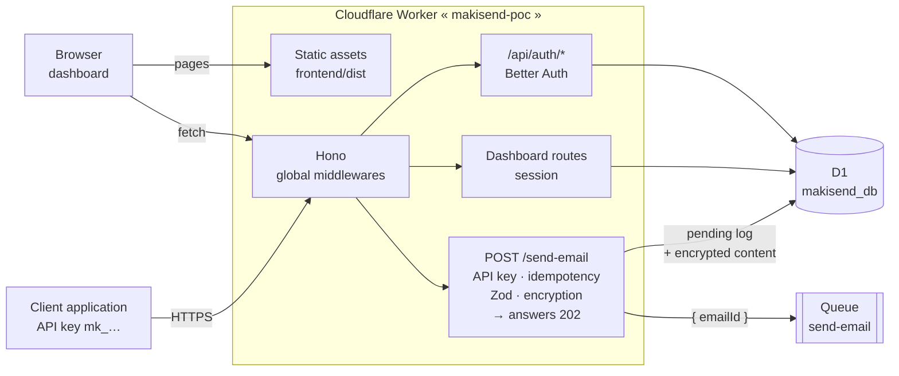
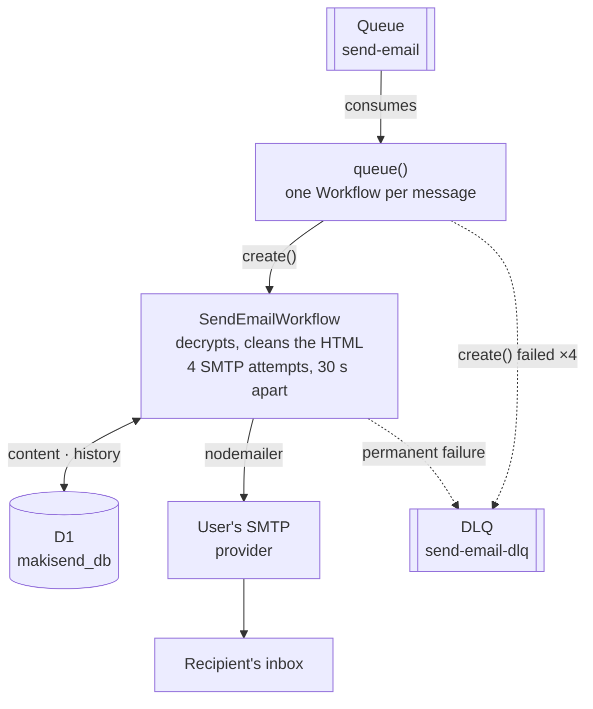

# MakiSend

MakiSend is a Proof of Concept (POC) for a serverless transactional email API, deployed on **Cloudflare Workers**.

The POC sets out to answer three questions:

1. Can a serverless backend that uses **nodemailer** and raw SMTP run on Cloudflare Workers?
2. Can it work at scale?
3. Can the emails land in the inbox rather than the spam folder?

For the full technical context (architecture, conventions, development workflow and limitations), see [`AGENTS.md`](./AGENTS.md) and [`docs/ARCHITECTURE.md`](./docs/ARCHITECTURE.md).

---

## Architecture

A single **Cloudflare Worker** serves both the dashboard (static Astro build) and the Hono API. Sending is **asynchronous**: the HTTP request encrypts the email, stores it in D1, queues its id and answers `202`; a **durable Workflow** then sends it over SMTP through the provider the user configured.

**1. HTTP request**: what happens during the call.



**2. Asynchronous delivery**: what happens after the `202`.



Outside these two paths, a daily **Cron Trigger** (`scheduled()`) tests every SMTP configuration and records the result in D1.

The journey of an email:

1. The client calls `POST /send-email` with its API key. The key determines the user **and** the SMTP configuration to use; the request body cannot choose them.
2. The Worker encrypts the recipient and the content, writes a `pending` log to D1, then queues `{ emailId }`. No personal data goes through the Queue.
3. The client gets `202` right away: the actual send has not happened yet.
4. The consumer starts one Workflow per email (the instance id is the `emailId`, so a duplicate is rejected).
5. The Workflow sends over SMTP. Every step appends a row to `email_histories`, visible in the dashboard.
6. Transient error: 3 more attempts, 30 s apart. Permanent error (auth, TLS, DNS, 5xx) or exhausted budget: status `failed` and DLQ.

The full architecture board (overview, workflow steps, data model, delivery and limits) is in [`makisend-design.excalidraw`](./makisend-design.excalidraw); open it on [excalidraw.com](https://excalidraw.com) or with the Excalidraw plugin for Obsidian / VS Code.

### Repository layout

```
makisend/
├── backend/     # Cloudflare Worker: Hono, Drizzle (D1), Queues, Workflows
│   ├── src/     # one folder per module: controller → service → repository + dto
│   ├── drizzle/ # SQL migrations
│   └── test/    # Vitest (unit + Miniflare integration)
├── frontend/    # Astro + React dashboard, built into frontend/dist
├── docs/        # Architecture and developer guide
└── .github/     # CI and deployment (GitHub Actions)
```

---

## Tech stack

- **Runtime**: Cloudflare Workers (`workerd`)
- **Web framework**: [Hono](https://hono.dev/)
- **Validation**: [Zod](https://zod.dev/) + `@hono/zod-validator`
- **ORM / database**: [Drizzle ORM](https://orm.drizzle.team/) + Cloudflare D1 (SQLite)
- **Email delivery**: [nodemailer](https://nodemailer.com/) over raw SMTP
- **Async delivery**: Cloudflare Queues + Cloudflare Workflows
- **Authentication**: [Better Auth](https://www.better-auth.com/) (dashboard sessions and API keys)
- **Architecture**: Repository / Service / Controller (inspired by NestJS)
- **Logging**: [Pino](https://getpino.io/), configured for the edge with no Node.js transport
- **Tests**: [Vitest](https://vitest.dev/)
- **API documentation**: OpenAPI 3.1 + [Scalar](https://scalar.com/)
- **Lint**: ESLint + TypeScript ESLint
- **Encryption**: Web Crypto API (AES-256-GCM)
- **HTML sanitization**: `sanitize-html`
- **Dashboard**: Astro + React (shadcn/ui)

---

## Prerequisites

- [Node.js](https://nodejs.org/) 22+
- [pnpm](https://pnpm.io/)
- A Cloudflare account with access to Workers and D1
- SMTP credentials from an email provider (SendGrid, Resend, Gmail, etc.)

---

## Installation

```bash
pnpm install
```

Copy the Worker's example environment file:

```bash
cp backend/.env.example backend/.env
```

Then fill in the values in `backend/.env` (see [Configuration](#configuration)).

---

## Configuration

The following variables are set in `backend/.env` and mapped in `backend/src/index.ts` through the `Bindings` type:

| Variable | Description |
|----------|-------------|
| `AES_256_KEY` | AES-256 key as a 64-character hex string. Generate it with `openssl rand -hex 32` |
| `BETTER_AUTH_SECRET` | Better Auth signing secret |
| `BETTER_AUTH_URL` | Base URL of the Worker (e.g. `http://localhost:8787`) |
| `FRONTEND_URL` | Allowed frontend origin (CORS / redirects) |

These are **no longer** environment variables:

- **SMTP credentials** (`SMTP_USER`, `SMTP_PASSWORD`, `SENDER_EMAIL`, `HOST`): stored per user, encrypted in D1, managed through the `smtp-config` module. Port and TLS mode (`tls` or `starttls`) belong to each configuration; port 25 is rejected.
- **`API_KEY`**: API keys are per user (`api-keys` module, Better Auth), sent as `x-api-key` or `Authorization: Bearer <API_KEY>`.

The variables are turned into a typed `Config` object by `createConfig()` and injected into the services.

---

## Available commands

Run them from `backend/` (start the frontend with `pnpm --filter frontend dev`).

| Command | Description |
|---------|-------------|
| `pnpm dev` | Starts the local development server |
| `pnpm cf-typegen` | Generates TypeScript types from the Wrangler configuration |
| `pnpm test` | Runs the tests in watch mode |
| `pnpm test:run` | Runs the tests once |
| `pnpm test:ui` | Runs the tests with the Vitest UI |
| `pnpm test:coverage` | Runs the tests with coverage |
| `pnpm lint` | Checks lint |
| `pnpm lint:fix` | Fixes lint issues automatically |

---

## Development with Docker

To develop without installing anything locally (besides Docker), the project ships a local development stack:

```bash
docker compose build   # or: pnpm docker:build
docker compose up -d   # or: pnpm docker:up
```

| URL | Service | Contents |
|-----|---------|----------|
| `http://localhost:8787` | `backend` | Worker through `wrangler dev --local` (D1, Queues and Workflows simulated locally by Miniflare) |
| `http://localhost:4321` | `frontend` | Astro dev server, Vite proxy to `http://backend:8787` |

- Hot reload works on both services (the repository is mounted as a volume).
- Local D1/Queues/Workflows state lives in `backend/.wrangler` (mounted from the host, kept after `docker compose down`).
- Wrangler reads `.env` and `.dev.vars` from the mounted working directory; no secret is copied into the image (excluded through `.dockerignore`).
- **Do not run `pnpm dev` on the host at the same time** (port 8787 conflict).

Offline commands (nothing to install on the host):

```bash
pnpm docker:test       # docker compose run --rm backend pnpm test:run
pnpm docker:lint       # docker compose run --rm backend pnpm lint
pnpm docker:migrate    # applies D1 migrations locally
pnpm docker:down       # stops the stack
```

Deployment to Cloudflare does not happen from Docker: it goes through GitHub Actions (see [Deployment](#deployment)).

A devcontainer (`.devcontainer/`) reuses the same compose file to open the project in VS Code / Cursor.

---

## API documentation

The Worker serves an interactive reference:

- **Guide built into the dashboard**: `/dashboard/api-docs` (authentication, delivery lifecycle, SMTP, templates, endpoints, errors)
- **Scalar**: `http://localhost:8787/docs` (or the deployed Worker's URL)
- **OpenAPI 3.1**: `http://localhost:8787/openapi.json`

Request schemas are generated from the Zod DTOs so they stay aligned with the actual validation.

## Endpoints

| Method | Route | Authentication | Description |
|--------|-------|----------------|-------------|
| `POST` | `/send-email` | API key (`x-api-key` or Bearer) | Queues an email; supports `Idempotency-Key`, inline content or `templateId` |
| `GET/POST` | `/smtp-config` | Session | Lists / creates an SMTP configuration |
| `GET/PUT/DELETE` | `/smtp-config/{id}` | Session | Reads / updates / deletes a configuration |
| `POST` | `/smtp-config/check` | Session | Tests unsaved credentials |
| `POST` | `/smtp-config/{id}/check` | Session | Tests a saved configuration |
| `POST` | `/smtp-config/{id}/test-send` | Session | Sends a test email (not logged) |
| `GET/POST` | `/api-keys` | Session | Lists / creates an API key linked to a configuration |
| `DELETE` | `/api-keys/{id}` | Session | Revokes an API key |
| `GET` | `/email-logs` | Session | Paginated logs (filters `status`, `smtpConfigId`, `to`) |
| `GET` | `/email-logs/{id}` | Session | One log and its history |
| `GET` | `/dashboard/stats`, `/dashboard/by-config`, `/dashboard/recent`, `/dashboard/errors` | Session | Delivery metrics |
| `GET/POST` | `/templates` | Session | Lists / creates a template |
| `GET/PUT/DELETE` | `/templates/{id}` | Session | Reads / updates / deletes a template |
| `POST` | `/templates/{id}/preview` | Session | Renders the template with sample variables |

The `/api/auth/*` routes are provided by [Better Auth](https://www.better-auth.com/) (sign-up, sign-in, session, sign-out).

### `POST /send-email`

Sends a transactional email to the given recipient.

#### Headers

| Header | Value |
|--------|-------|
| `Content-Type` | `application/json` |
| `x-api-key` or `Authorization` | `Bearer <API_KEY>` *(per-user API key, created through Better Auth)* |

#### Body

```json
{
  "to": "recipient@example.com",
  "subject": "Email subject",
  "text": "Plain-text version of the message (min. 10 characters).",
  "html": "<p>HTML version of the message.</p>"
}
```

| Field | Type | Constraints |
|-------|------|-------------|
| `to` | string | Valid email |
| `subject` | string | At least 3 characters |
| `text` | string | At least 10 characters |
| `html` | string | Not empty, sanitized before sending |


## Deployment

Deployment goes **only through GitHub Actions** (`.github/workflows/deploy.yml`); nothing is deployed from a local machine.

| Trigger | Job | Effect |
|---------|-----|--------|
| Pull request to `main` or `dev` | `Deploy preview to Cloudflare` | Worker `makisend-poc-preview`, with a D1 database recreated on every deploy and its own `-preview` queues |
| Push | `Deploy to Cloudflare (production)` | Remote D1 migrations, queue creation if needed, then `wrangler deploy` of the `makisend-poc` Worker |

Both jobs depend on `Verify and build` (lint, tests, frontend build). The Cloudflare configuration lives in `backend/wrangler.jsonc`: Worker `makisend-poc`, entry point `src/index.ts`, compatibility date `2026-07-10` with `nodejs_compat`, D1 `makisend_db`, queue `makisend-send-email` and its DLQ, Workflow `makisend-send-email`, daily cron.

Secrets to define in the GitHub repository: `CLOUDFLARE_API_TOKEN`, `CLOUDFLARE_ACCOUNT_ID`, `AES_256_KEY`, `BETTER_AUTH_SECRET`. The production Worker reads its own Cloudflare secrets (`AES_256_KEY`, `BETTER_AUTH_SECRET`, `BETTER_AUTH_URL`, `FRONTEND_URL`); the job checks that they exist after deploying.

> SMTP credentials are not Worker secrets: they are encrypted in D1 and managed per user (`smtp-config` module).

---

## Security

- **Authentication**: the `api-key.middleware.ts` middleware verifies per-user API keys through Better Auth (`401` missing header, `403` invalid key), sent as `x-api-key: <API_KEY>` or `Authorization: Bearer <API_KEY>`. Keys are created and revoked through the `api-keys` module. Dashboard routes use the Better Auth session.
- **SMTP passwords**: encrypted at rest and never returned by the API (responses only expose the id, host, port, TLS mode, username and sender).
- **Encryption**: the recipient address is encrypted with AES-256-GCM before it is stored.
- **HTML sanitization**: HTML content is cleaned with `sanitize-html` before sending.
- **Verified TLS**: SMTP connections use `rejectUnauthorized: true`.
- **Strict validation**: payloads are validated with Zod `.strict()`, which rejects unexpected fields.

### Current security limitations

- **Global rate limiting, not configurable per tenant**: Better Auth limits sign-in attempts and each API key (10,000 requests/day by default).
- Per-user API keys, but no scopes and no automatic rotation.
- No webhook or origin-verification signature.
- No dedicated audit logs beyond the Pino application logs.

---

## Known limitations and constraints

### Serverless-related

- **Limited execution time**: a long SMTP exchange can fail because of the Workers CPU limits.
- **Cold start**: the first invocation may see extra latency.
- **Cost**: large volumes or long executions can become expensive.
- **Long-lived connections are inefficient**: opening an SMTP connection for every send is not optimal.

### POC-related

- **Asynchronous** sending: `POST /send-email` answers `202 Accepted` as soon as the email is queued; delivery (Cloudflare Queues → Workflow → SMTP) happens afterwards and is only visible in the D1 logs.
- **One SMTP provider per configuration**: credentials are stored per user in D1 (encrypted), with no multi-provider routing or failover. Port and TLS mode are configurable per configuration.
- **Bounded retries**: one initial SMTP attempt + **3 retries 30 s apart** within the same workflow. A permanent failure (auth, TLS, DNS, config, 5xx) stops immediately; once the budget is exhausted, the email is marked `failed` and sent to the DLQ. The Queue consumer only retries starting the workflow (exponential backoff, then DLQ).
- **No tracking**: no bounce, open or click tracking. Only send logs are stored.
- **D1 is a serverless SQLite database**: latency is possible, and it is not suited to very high volumes without caching.
- **Deliverability**: SPF, DKIM, DMARC and IP reputation depend on the SMTP provider and the sender domain.

---

## Roadmap

### POC (current)

- `POST /send-email` endpoint with per-user API key authentication
- Asynchronous pipeline: Cloudflare Queues → durable Workflow → SMTP, with bounded retries and a DLQ
- Delivery through nodemailer + raw SMTP, port and TLS configurable per SMTP configuration
- Reusable templates with the full React Email visual builder (inspector, themes, export) or pasted TSX, preview and variables; encrypted logs and HTTP idempotency
- On-demand SMTP connection check + scheduled daily health check
- OpenAPI 3.1 documentation served by Scalar (`/docs`, `/openapi.json`)
- Route / service / middleware unit tests + integration tests
- GitHub Actions CI (lint, typecheck, tests, frontend build) on PRs and pushes to `main` and `dev`
- Deployment test on Cloudflare Workers

### Internal MVP

- ~~Secure the endpoint~~ (done: per-user API keys through Better Auth)
- ~~Manage SMTP credentials through D1 / seeding~~ (done: `smtp-config` module, encrypted)
- ~~Delivery monitoring and metrics~~ (done: `dashboard` + `email-logs` modules)

### Public beta MVP

- Message queues and jobs: already in place (see POC); scale and throughput tuning remains
- Scale and throughput management
- Deliverability improvements (anti-spam, SPF/DKIM/DMARC)

---

## Useful resources

- [Hono](https://hono.dev/)
- [Drizzle ORM](https://orm.drizzle.team/)
- [Cloudflare Workers](https://developers.cloudflare.com/workers/)
- [Cloudflare D1](https://developers.cloudflare.com/d1/)
- [Cloudflare Queues](https://developers.cloudflare.com/queues/)
- [Cloudflare Workflows](https://developers.cloudflare.com/workflows/)
- [nodemailer](https://nodemailer.com/)
