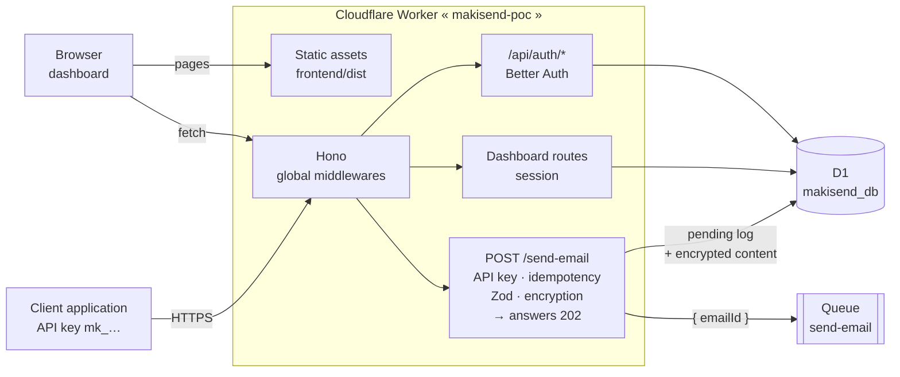
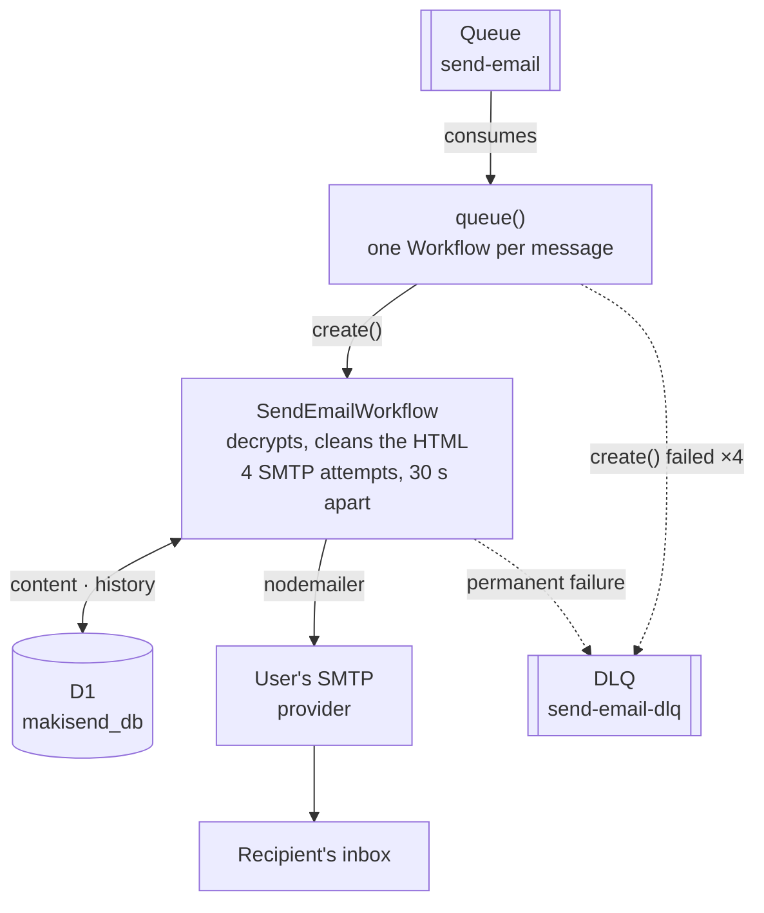

# MakiSend

**Transactional email, one API call away. No mail server to run.**

[](https://deploy.workers.cloudflare.com/?url=https://github.com/lixalistudio-oss/makisend)

MakiSend is a self-hosted, serverless email API on **Cloudflare Workers**. Your app sends one authenticated `POST /send-email`; MakiSend encrypts and queues the message, then delivers it through **your own SMTP provider** with automatic retries, and shows every delivery in a dashboard.

## Why MakiSend

- **No server to run.** One Worker serves the API and the dashboard; Queues and Workflows handle delivery.
- **Bring your own SMTP.** Zoho, Gmail, Microsoft 365, Resend, SendGrid, Mailgun or Cloudflare Email Service. You keep your sender domain and reputation.
- **Reliable delivery.** `202` right away, then a durable Workflow with bounded retries and a dead-letter queue.
- **Inbox, not spam.** In our tests, MakiSend emails land in the inbox, not the spam folder, once SPF, DKIM and DMARC are set on the sender domain.
- **Fast enough to feel instant.** Once queued, an email reaches the SMTP provider in 300–400 ms in the best cases and about 2 seconds in the worst. Most of that time is SMTP itself (see [Delivery speed](#delivery-speed)).
- **Private by default.** Recipients, bodies, attachments and SMTP credentials are encrypted with AES-256-GCM before they reach D1.
- **Built for teams of one.** Per-user API keys, optional per-key send quota, idempotency keys, 2FA, and a dashboard with logs, metrics and templates.
- **Resend-shaped API.** Same `attachments` format, so a client written for Resend sends the same JSON.

> **Status: early.** The sending pipeline, dashboard and security basics work end to end. Outgoing webhooks to your application, bounce processing for mailbox providers (Gmail, Zoho, Microsoft 365) and multi-provider failover are not built yet (see [Roadmap](#roadmap) and [Known limitations](#known-limitations-and-constraints)).

For the full technical context (architecture, conventions, development workflow and limitations), see [`AGENTS.md`](./AGENTS.md) and [`docs/ARCHITECTURE.md`](./docs/ARCHITECTURE.md).

---

## Architecture

A single **Cloudflare Worker** serves both the dashboard (static Astro build) and the Hono API. Sending is **asynchronous**: the HTTP request encrypts the email, stores it in D1, queues its id and answers `202`; a **durable Workflow** then sends it over SMTP through the provider the user configured.

**1. HTTP request**: what happens during the call.



**2. Asynchronous delivery**: what happens after the `202`.



Outside these two paths, a daily **Cron Trigger** (`scheduled()`) tests every SMTP configuration and records the result in D1.

The journey of an email:

1. The client calls `POST /send-email` with its API key. The key determines the user **and** the SMTP configuration to use; the request body cannot choose them.
2. The Worker encrypts the recipient and the content, writes a `pending` log to D1, then queues `{ emailId }`. No personal data goes through the Queue.
3. The client gets `202` right away: the actual send has not happened yet.
4. The consumer starts one Workflow per email (the instance id is the `emailId`, so a duplicate is rejected).
5. The Workflow sends over SMTP. Every step appends a row to `email_histories`, visible in the dashboard.
6. Transient error: 3 more attempts, 30 s apart. Permanent error (auth, TLS, DNS, 5xx) or exhausted budget: status `failed` and DLQ.

The full architecture board (overview, workflow steps, data model, delivery and limits) is in [`makisend-design.excalidraw`](./makisend-design.excalidraw); open it on [excalidraw.com](https://excalidraw.com) or with the Excalidraw plugin for Obsidian / VS Code.

### Repository layout

```
makisend/
├── backend/     # Cloudflare Worker: Hono, Drizzle (D1), Queues, Workflows
│   ├── src/     # one folder per module: controller → service → repository + dto
│   ├── drizzle/ # SQL migrations
│   └── test/    # Vitest (unit + Miniflare integration)
├── frontend/    # Astro + React dashboard, built into frontend/dist
├── docs/        # Architecture and developer guide
└── .github/     # CI and deployment (GitHub Actions)
```

---

## Design

[`DESIGN.md`](./DESIGN.md) is the visual system of the dashboard and of the website ([makisend-website](https://github.com/lixalistudio-oss/makisend-website)): neutral [Arc UI](https://uiarc.dev) surfaces, one MakiSend green (`#0f6b4f`) spent only on what is active, selected or in progress, Geist for headings, Inter for text, weights 400 and 500, sentence case. The dashboard maps these tokens onto its shadcn variables in `frontend/src/styles/global.css`; change a token in `DESIGN.md` first, then there and in the website.

## Tech stack

- **Runtime**: Cloudflare Workers (`workerd`)
- **Web framework**: [Hono](https://hono.dev/)
- **Validation**: [Zod](https://zod.dev/) + `@hono/zod-validator`
- **ORM / database**: [Drizzle ORM](https://orm.drizzle.team/) + Cloudflare D1 (SQLite)
- **Email delivery**: [nodemailer](https://nodemailer.com/) over raw SMTP
- **Async delivery**: Cloudflare Queues + Cloudflare Workflows
- **Authentication**: [Better Auth](https://www.better-auth.com/) (dashboard sessions and API keys)
- **Architecture**: Repository / Service / Controller (inspired by NestJS)
- **Logging**: [Pino](https://getpino.io/), configured for the edge with no Node.js transport
- **Tests**: [Vitest](https://vitest.dev/)
- **API documentation**: OpenAPI 3.1 + [Scalar](https://scalar.com/)
- **Lint**: ESLint + TypeScript ESLint
- **Encryption**: Web Crypto API (AES-256-GCM)
- **HTML sanitization**: `sanitize-html`
- **Dashboard**: Astro + React (shadcn/ui)

---

## Prerequisites

- [Node.js](https://nodejs.org/) 22+
- [pnpm](https://pnpm.io/)
- A Cloudflare account with access to Workers and D1
- SMTP credentials from an email provider (SendGrid, Resend, Gmail, etc.)

---

## Installation

```bash
pnpm install
```

Copy the Worker's example environment file:

```bash
cp backend/.env.example backend/.env
```

Then fill in the values in `backend/.env` (see [Configuration](#configuration)).

---

## Configuration

The following variables are set in `backend/.env` and mapped in `backend/src/index.ts` through the `Bindings` type:

| Variable | Description |
|----------|-------------|
| `ENCRYPTION_KEY` | AES-256 key as a 64-character hex string. Generate it with `openssl rand -hex 32`. The legacy name `AES_256_KEY` is still read |
| `ENCRYPTION_KEY_PREVIOUS` | Optional, during a key rotation: previous keys, comma-separated (decrypt only) |
| `BETTER_AUTH_SECRET` | Better Auth signing secret; also encrypts the TOTP secrets (changing it breaks existing 2FA set-ups) |
| `BETTER_AUTH_URL` | Base URL of the Worker (e.g. `http://localhost:8787`) |
| `FRONTEND_URL` | Allowed frontend origin (CORS / redirects) |
| `SEND_RATE_LIMIT` | Optional per-API-key send quota on `POST /send-email`, e.g. `100/min` or `5000/day` (units `s`, `min`, `hour`, `day`). Unset: no quota. Over it: `429` with `Retry-After` |
| `UPDATE_CHECK` | Optional. `off` stops the daily new-release check (no request to GitHub). See [Updates](#updates) |
| `MAKISEND_REPOSITORY` | Optional. Your copy of the repository (`owner/name`): the dashboard's **Update** button opens its sync workflow |
| `UPDATE_SOURCE_REPOSITORY` | Optional. Read releases from another repository (`owner/name`). Default `lixalistudio-oss/makisend` |

`BETTER_AUTH_URL` and `FRONTEND_URL` may be left unset on a deployed Worker: the dashboard and the API share one origin, so the Worker then uses the origin the request arrived on.

These are **no longer** environment variables:

- **SMTP credentials** (`SMTP_USER`, `SMTP_PASSWORD`, `SENDER_EMAIL`, `HOST`): stored per user, encrypted in D1, managed through the `smtp-config` module. Port and TLS mode (`tls` or `starttls`) belong to each configuration; port 25 is rejected.
- **`API_KEY`**: API keys are per user (`api-keys` module, Better Auth), sent as `x-api-key` or `Authorization: Bearer <API_KEY>`.

The variables are turned into a typed `Config` object by `createConfig()` and injected into the services.

---

## Available commands

Run them from `backend/` (start the frontend with `pnpm --filter frontend dev`).

| Command | Description |
|---------|-------------|
| `pnpm dev` | Starts the local development server |
| `pnpm cf-typegen` | Generates TypeScript types from the Wrangler configuration |
| `pnpm test` | Runs the tests in watch mode |
| `pnpm test:run` | Runs the tests once |
| `pnpm test:ui` | Runs the tests with the Vitest UI |
| `pnpm test:coverage` | Runs the tests with coverage |
| `pnpm lint` | Checks lint |
| `pnpm lint:fix` | Fixes lint issues automatically |

---

## Development with Docker

To develop without installing anything locally (besides Docker), the project ships a local development stack:

```bash
docker compose build   # or: pnpm docker:build
docker compose up -d   # or: pnpm docker:up
```

| URL | Service | Contents |
|-----|---------|----------|
| `http://localhost:8787` | `backend` | Worker through `wrangler dev --local` (D1, Queues and Workflows simulated locally by Miniflare) |
| `http://localhost:4321` | `frontend` | Astro dev server, Vite proxy to `http://backend:8787` |

- Hot reload works on both services (the repository is mounted as a volume).
- Local D1/Queues/Workflows state lives in `backend/.wrangler` (mounted from the host, kept after `docker compose down`).
- Wrangler reads `.env` and `.dev.vars` from the mounted working directory; no secret is copied into the image (excluded through `.dockerignore`).
- **Do not run `pnpm dev` on the host at the same time** (port 8787 conflict).

Offline commands (nothing to install on the host):

```bash
pnpm docker:test       # docker compose run --rm backend pnpm test:run
pnpm docker:lint       # docker compose run --rm backend pnpm lint
pnpm docker:migrate    # applies D1 migrations locally
pnpm docker:down       # stops the stack
```

Deployment to Cloudflare does not happen from Docker: it goes through GitHub Actions (see [Deployment](#deployment)).

A devcontainer (`.devcontainer/`) reuses the same compose file to open the project in VS Code / Cursor.

---

## SMTP providers

The SMTP form offers presets that fill the hostname, port and security: Zoho Mail, Gmail / Google Workspace, Microsoft 365, Resend, SendGrid, Mailgun and Cloudflare Email Service, each with what the form cannot guess (app password, `apikey` user name...). A pasted URL (`https://smtp.zoho.com:587/`) is cleaned into a hostname and a port. The credentials can be checked before saving, and a saved configuration can send a test email from the dashboard.

**Cloudflare Email Service** (`smtp.mx.cloudflare.net`): a Worker cannot open an SMTP socket to it, so a configuration on that host is sent through the Worker's `send_email` binding (`EMAIL`, declared in `wrangler.jsonc`) instead; the user name and password are not used. The sender address must use a domain onboarded to Cloudflare Email Sending. The connection check, the test send and the daily health check use the binding too.

## API documentation

The Worker serves an interactive reference:

- **Guide built into the dashboard**: `/dashboard/api-docs` (authentication, delivery lifecycle, SMTP, templates, endpoints, errors)
- **Scalar**: `http://localhost:8787/docs` (or the deployed Worker's URL)
- **OpenAPI 3.1**: `http://localhost:8787/openapi.json`

Request schemas are generated from the Zod DTOs so they stay aligned with the actual validation.

## Endpoints

| Method | Route | Authentication | Description |
|--------|-------|----------------|-------------|
| `POST` | `/send-email` | API key (`x-api-key` or Bearer) | Queues an email; supports `Idempotency-Key`, inline content or `templateId` |
| `GET/POST` | `/smtp-config` | Session | Lists / creates an SMTP configuration |
| `GET/PUT/DELETE` | `/smtp-config/{id}` | Session | Reads / updates / deletes a configuration |
| `POST` | `/smtp-config/check` | Session | Tests unsaved credentials |
| `POST` | `/smtp-config/{id}/check` | Session | Tests a saved configuration |
| `POST` | `/smtp-config/{id}/test-send` | Session | Sends a test email (logged with `source: "test"`, never counted in the dashboard totals); takes the same optional `attachments` as `/send-email` |
| `GET` | `/smtp-config/{id}/dns-check` | Session | SPF, DKIM, DMARC and MX of the sender domain, read from public DNS (`?dkimSelector=` optional) |
| `PUT/DELETE` | `/smtp-config/{id}/bounce-webhook` | Session | Connects / disconnects the provider's bounce webhook (provider + secret; the secret is never returned) |
| `POST` | `/webhooks/bounces/{smtpConfigId}` | Provider signature | Receives the provider's delivery events (Resend, SendGrid, Mailgun, Postmark) |
| `GET/POST` | `/suppressions` | Session | Lists / adds suppressed addresses (refused by `/send-email` with `422`) |
| `DELETE` | `/suppressions/{id}` | Session | Removes an address from the suppression list |
| `GET/POST` | `/api-keys` | Session | Lists / creates an API key linked to a configuration (several keys can share one) |
| `DELETE` | `/api-keys/{id}` | Session | Revokes an API key |
| `GET` | `/email-logs` | Session | Paginated logs (filters `status`, `smtpConfigId`, `apiKeyId`, `to`) |
| `GET` | `/email-logs/{id}` | Session | One log and its history |
| `GET` | `/dashboard/stats`, `/dashboard/by-config`, `/dashboard/by-api-key`, `/dashboard/recent`, `/dashboard/errors` | Session | Delivery metrics (API sends only; `stats` and `errors` take an optional `apiKeyId`) |
| `GET/POST` | `/templates` | Session | Lists / creates a template |
| `GET/PUT/DELETE` | `/templates/{id}` | Session | Reads / updates / deletes a template |
| `GET` | `/updates/status` | Session | Installed and latest MakiSend versions (`?refresh=true` checks now) |
| `POST` | `/templates/{id}/preview` | Session | Renders the template with sample variables |

The `/api/auth/*` routes are provided by [Better Auth](https://www.better-auth.com/) (sign-up, sign-in, session, sign-out).

### `POST /send-email`

Sends a transactional email to the given recipient.

#### Headers

| Header | Value |
|--------|-------|
| `Content-Type` | `application/json` |
| `x-api-key` or `Authorization` | `Bearer <API_KEY>` *(per-user API key, created through Better Auth)* |

#### Body

```json
{
  "to": "recipient@example.com",
  "subject": "Email subject",
  "text": "Plain-text version of the message (min. 10 characters).",
  "html": "<p>HTML version of the message.</p>"
}
```

| Field | Type | Constraints |
|-------|------|-------------|
| `to` | string | Valid email |
| `subject` | string | At least 3 characters |
| `text` | string | At least 10 characters |
| `html` | string | Not empty, sanitized before sending |
| `attachments` | array, optional | Resend's shape: `[{ "filename", "content", "content_type"? }]`; also accepted with `templateId` |
| `reply_to` | string, optional | Address replies go to; also accepted with `templateId` |
| `headers` | object, optional | Custom headers (see below); also accepted with `templateId` |

A recipient on the suppression list is refused with `422` before anything is stored or queued (see [Deliverability](#deliverability)).

#### Custom headers

```json
"reply_to": "support@example.com",
"headers": {
  "List-Unsubscribe": "<https://example.com/unsubscribe?u=42>, <mailto:unsubscribe@example.com>",
  "List-Unsubscribe-Post": "List-Unsubscribe=One-Click",
  "X-Entity-Ref-ID": "order-1234"
}
```

The accepted set is Cloudflare Email Service's allowlist, applied to every transport so one payload behaves the same over SMTP and the `send_email` binding:

- any `X-` header (name `X-[A-Za-z0-9_-]+`, up to 100 characters);
- `In-Reply-To`, `References`, `Thread-Index`, `Thread-Topic`;
- `List-Unsubscribe` (`<https://…>` and/or `<mailto:…>`, plain `http` refused), `List-Unsubscribe-Post` (exactly `List-Unsubscribe=One-Click`, with an `https` unsubscribe link), `List-Id`, `List-Archive`, `List-Help`, `List-Owner`, `List-Post`, `List-Subscribe`;
- `Precedence` (`bulk`, `list` or `junk`).

`From`, `To`, `Cc`, `Bcc`, `Subject` and `Reply-To` have their own fields; `Date`, `Message-ID`, `MIME-Version`, `Content-*`, `DKIM-Signature`, `Return-Path` and `Received` are written by the transport. Values cannot contain line breaks or control characters (header injection), at most 2048 bytes each and 50 headers. `reply_to` and `headers` are stored AES-GCM encrypted (`email_contents`) and re-encrypted by the key rotation.

#### Attachments

The same shape as Resend's API, so a client written for Resend sends the same JSON.

```json
"attachments": [
  { "filename": "receipt-REC-1.pdf", "content": "JVBERi0xLjQK…", "content_type": "application/pdf" }
]
```

- `content`: the file as base64 (standard alphabet, no line breaks).
- `content_type`: optional, defaults to `application/octet-stream`; a MIME type with no parameter.
- At most 5 files, at most 512 KB each (decoded).
- `filename`: at most 200 characters, no control characters, no `/` or `\`.
- Resend's `path` field (a URL to fetch) is refused: MakiSend fetches no URL on a caller's behalf.
- Files are stored AES-GCM encrypted in D1, one row per file (`email_attachments`), never travel through the queue, are re-encrypted by the key rotation and are deleted with the email.
- Both senders carry them: SMTP (nodemailer) and Cloudflare Email Service (the `send_email` binding).

#### Try an attachment from the dashboard

**SMTP Config → Send test email** takes files too (**Attach a file**), with the same limits as the API: 5 files, 512 KB each. The dialog checks size and count before sending; the backend validates them exactly like `/send-email` (`POST /smtp-config/:id/test-send`, same `attachments` field). A test send is logged like any other email, tagged `test`.

#### End-to-end test

```bash
cd backend && pnpm test:e2e:attachments
```

Starts the Worker under `wrangler dev` (local D1, Queues and Workflows, nothing deployed) and sends two files through both doors: the dashboard's test send and `POST /send-email` (queue, then workflow). The configuration targets Cloudflare Email Service; locally Miniflare writes every attachment the `send_email` binding receives to a file, which the test reads back and compares byte for byte. It also checks that a message without attachments carries none, and that both doors refuse the same invalid files. Report: `backend/test/e2e/reports/attachments.json` (deterministic, to diff between runs). `backend/test/e2e/send-email-attachments.e2e.test.ts` covers the SMTP path with a real TLS server.


## Deployment

Deployment goes **only through GitHub Actions** (`.github/workflows/deploy.yml`); nothing is deployed from a local machine.

| Trigger | Job | Effect |
|---------|-----|--------|
| Pull request to `main` or `dev` | `Deploy preview to Cloudflare` | Worker `makisend-poc-preview`, with a D1 database recreated on every deploy and its own `-preview` queues |
| Push | `Deploy to Cloudflare (production)` | Remote D1 migrations, queue creation if needed, then `wrangler deploy` of the `makisend-poc` Worker |

Both jobs depend on `Verify and build` (lint, tests, frontend build). The Cloudflare configuration lives in `backend/wrangler.jsonc`: Worker `makisend-poc`, entry point `src/index.ts`, compatibility date `2026-07-10` with `nodejs_compat`, D1 `makisend_db`, queue `makisend-send-email` and its DLQ, Workflow `makisend-send-email`, daily cron (SMTP health checks) and hourly cron (key rotation).

Secrets to define in the GitHub repository: `CLOUDFLARE_API_TOKEN`, `CLOUDFLARE_ACCOUNT_ID`, `AES_256_KEY` (preview), `BETTER_AUTH_SECRET`. The production Worker reads its own Cloudflare secrets (`ENCRYPTION_KEY` or the legacy `AES_256_KEY`, `BETTER_AUTH_SECRET`, `BETTER_AUTH_URL`, `FRONTEND_URL`); the job checks that they exist after deploying.

> SMTP credentials are not Worker secrets: they are encrypted in D1 and managed per user (`smtp-config` module).

### Deploy to Cloudflare (one click)

[](https://deploy.workers.cloudflare.com/?url=https://github.com/lixalistudio-oss/makisend)

The button opens the Cloudflare dashboard of the account you are signed in to and:

1. copies this repository into your GitHub (or GitLab) account;
2. lets you name the Worker, the D1 database and the queues, and asks for the two secrets (`ENCRYPTION_KEY`: `openssl rand -hex 32`, **keep a copy**; `BETTER_AUTH_SECRET`: `openssl rand -base64 32`);
3. creates the D1 database and the queues, then builds and deploys with Workers Builds: `pnpm run build` (dashboard) and `pnpm run deploy` (D1 migrations, then `wrangler deploy`).

Open the Worker's URL: the first connection creates the administrator account. Then turn on 2FA and, if the API is reachable from the internet, set `SEND_RATE_LIMIT`.

How it is wired: the button reads the **root** `wrangler.jsonc` and `package.json` (`cloudflare.bindings` holds the secret descriptions, `.dev.vars.example` the secret names). Our own deployments keep using `backend/wrangler.jsonc` through GitHub Actions; `backend/test/unit/config/root-wrangler.test.ts` fails when the two configurations drift apart. The root `deploy` script (`scripts/workers-builds-deploy.sh`) refuses to run outside Workers Builds (`WORKERS_CI=1`), and the GitHub Actions deploy jobs only run in `lixalistudio-oss/makisend`, never in a copy.

### Updates

The dashboard shows a banner when a newer release is published, with its notes and an **Update** button; **Settings → MakiSend version** shows the installed and latest versions and a **Check now** button. The Worker reads the latest GitHub release of `lixalistudio-oss/makisend` once a day (daily cron, result cached in D1, unauthenticated, nothing about the instance is sent); `UPDATE_CHECK=off` turns it off.

Installing an update means merging the release into your copy of the repository, which redeploys it through Workers Builds: run the **Sync with upstream** workflow shipped in every copy (`.github/workflows/sync-upstream.yml`, it keeps your `wrangler.jsonc`), or merge by hand. Full guide, token note and rollback: [`docs/UPDATING.md`](docs/UPDATING.md).

Releases are cut by bumping `version` in the root `package.json` and `APP_VERSION` in `backend/src/core/version.ts`; on `main`, `.github/workflows/release.yml` tags `vX.Y.Z` and publishes the GitHub release.

### Self-hosting with an agent

[`docs/AGENT_SELF_HOST.md`](docs/AGENT_SELF_HOST.md) is a prompt to paste into a coding agent: it reads the repo, creates the resources on your own Cloudflare account with the `cf` CLI, sets the secrets, deploys, and applies the security practices (instance claimed at once, 2FA, `SEND_RATE_LIMIT`, key rotation, SPF/DKIM/DMARC).

---

## Security

- **Authentication**: the `api-key.middleware.ts` middleware verifies per-user API keys through Better Auth (`401` missing header, `403` invalid key), sent as `x-api-key: <API_KEY>` or `Authorization: Bearer <API_KEY>`. Keys are created and revoked through the `api-keys` module. Dashboard routes use the Better Auth session.
- **SMTP passwords**: encrypted at rest and never returned by the API (responses only expose the id, host, port, TLS mode, username and sender).
- **Encryption**: SMTP credentials, recipients and email bodies are encrypted with AES-256-GCM before they are stored.
- **Key rotation**: copy the current key into `ENCRYPTION_KEY_PREVIOUS`, set a new `ENCRYPTION_KEY`; the hourly cron re-encrypts everything and logs `remaining`. Once it logs `remaining: 0` and `failed: 0`, delete `ENCRYPTION_KEY_PREVIOUS`. Never replace the key outright while the database holds data.
- **One account, the super admin**: the first connection to the dashboard (`/setup`, email + password) creates the only account; every later account creation is refused (403), atomically, on every creation path. Deleting the account makes the instance configurable again.
- **Two-factor authentication**: TOTP (Google Authenticator, 1Password, Authy...) from Settings, with backup codes and an optional 30-day trusted device. Once it is on, the account can opt in to sign in with its email and a code only (no password); off by default, one use per code, 10 wrong codes lock the account for 15 minutes.
- **HTML sanitization**: HTML content is cleaned with `sanitize-html` before sending.
- **Verified TLS**: SMTP connections use `rejectUnauthorized: true`.
- **Strict validation**: payloads are validated with Zod `.strict()`, which rejects unexpected fields.

### Current security limitations

- **Send quota is opt-in**: sign-in attempts are always rate limited per IP, but API keys have no send quota unless `SEND_RATE_LIMIT` is set (e.g. `100/min`). Without it, a leaked key can send until it is deleted (SMTP quotas are the real limit). Set it on any instance whose API is reachable from the internet: `cf workers secrets update SEND_RATE_LIMIT --worker <worker> --type secret_text --text "100/min"`.
- Per-user API keys, but no scopes and no automatic rotation.
- No password reset by email.
- No webhook or origin-verification signature.
- No dedicated audit logs beyond the Pino application logs.

---

## Delivery speed

`POST /send-email` answers `202` in milliseconds; the send itself happens right after, in the Workflow. Measured from there to the provider accepting the message:

| Case | Time to the SMTP provider |
|------|---------------------------|
| Best case | 300–400 ms |
| Worst case | about 2 s |

Most of that time is the SMTP protocol, not MakiSend. SMTP waits for a reply to each command before sending the next one ([RFC 5321](https://www.rfc-editor.org/rfc/rfc5321)), and [RFC 2920](https://www.rfc-editor.org/rfc/rfc2920) notes that on high-latency links this turnaround time dominates the connection. One send is a chain of round trips: TCP connect, TLS handshake, `EHLO`, `AUTH`, `MAIL FROM`, `RCPT TO`, `DATA`, the message, then `QUIT`. Commonly cited figures put an SMTP send at 200 ms to 1 s per email, often more on a slow provider or a distant server, against roughly 100–500 ms for an HTTP email API ([comparison](https://resources.mailertogo.com/comparisons/smtp-relay-vs-email-api-developers-complete-comparison)). A Worker opens a fresh connection for every email, so each send pays the full handshake.

Delivery to the recipient's inbox comes after that and depends on the receiving server.

## Deliverability

MakiSend does not sign mail: SPF, DKIM and DMARC are published on the sender domain with the values your SMTP provider gives you. What MakiSend does:

- **DNS check.** **SMTP configuration → Check DNS records** (`GET /smtp-config/{id}/dns-check`) reads the sender domain's SPF, DKIM, DMARC and MX over DNS-over-HTTPS and grades each one (OK, needs attention, problem, unknown) with the record it found and where it lives. DKIM selectors are provider-specific: without one, the usual selectors are tried, and finding none answers *unknown*, not *problem*. A subdomain sender falls back to the organizational domain's DMARC record.
- **Suppression list.** When the recipient's server rejects the address itself during `RCPT TO` with a permanent status (`550 5.1.1` user unknown, `5.1.2`, `5.1.3`, `5.1.6`, `5.1.10`, `5.2.1`, or a 550/551/553 that says the mailbox does not exist), the workflow adds it to the list, and `POST /send-email` then answers `422` for that address. Policy refusals (`5.7.x`), full mailboxes (`5.2.2`) and temporary statuses never suppress: removing a working address is the worse mistake. Entries can be added and removed in **Settings → Suppression list** (`/suppressions`). Addresses are AES-GCM encrypted; lookups use a keyed HMAC of the lower-cased address, re-hashed by the key-rotation job.
- **Bounce webhook.** Most providers accept every recipient at `RCPT TO` and bounce later. **SMTP configuration → Bounce webhook** connects the provider's own delivery webhook to `POST /webhooks/bounces/{id}`: Resend (Svix signature), SendGrid (Signed Event Webhook, ECDSA), Mailgun (signing key) or Postmark (Basic auth password). Delivered, delayed, bounced and spam-complaint events are appended to the email's history in the logs; a hard bounce on a dead address or a spam complaint adds the address to the suppression list, with the same rule as above (a policy or content refusal never suppresses). Nothing has to move to Cloudflare: the domain stays at its registrar and the provider keeps sending.
  - Each SMTP send carries `Message-ID: <emailId@sender-domain>`, plus the tag the provider echoes back (`X-SMTPAPI` unique_args for SendGrid, `X-Mailgun-Variables`, `X-PM-Metadata-makisend-email-id` for Postmark), so an event finds its email. An event only touches an email the configuration's owner sent to the address it names; an event that matches no email still suppresses the address it reports.
  - Each event is applied once (`delivery_events`, unique on configuration + provider event id, kept 30 days); the secret is AES-GCM encrypted and covered by the key rotation. An unknown configuration, one without a webhook and a bad signature all answer `401`.
- **`List-Unsubscribe` and `reply_to`**: see [Custom headers](#custom-headers). Gmail and Yahoo require one-click unsubscribe for bulk senders.

Limit: mailbox providers (Gmail, Zoho, Microsoft 365) have no delivery webhook. Their later bounces arrive as emails in the sender's mailbox and are not read yet, so for them the suppression list still only learns from synchronous rejections. Cloudflare Email Service sends no webhook either.

## Known limitations and constraints

### Serverless-related

- **No fixed outbound IP**: Workers connect from shared, changing Cloudflare IPs, so an SMTP provider that requires IP allow-listing will refuse or destabilize sends. Disable allow-listing at the provider and rely on the SMTP credentials, or run the service on a server with a fixed IP and allow-list that IP.

### Current scope

- **Asynchronous** sending: `POST /send-email` answers `202 Accepted` as soon as the email is queued; delivery (Cloudflare Queues → Workflow → SMTP) happens afterwards and is only visible in the D1 logs.
- **One SMTP provider per configuration**: credentials are stored per user in D1 (encrypted), with no multi-provider routing or failover. Port and TLS mode are configurable per configuration.
- **Bounded retries**: one initial SMTP attempt + **3 retries 30 s apart** within the same workflow. A permanent failure (auth, TLS, DNS, config, 5xx) stops immediately; once the budget is exhausted, the email is marked `failed` and sent to the DLQ. The Queue consumer only retries starting the workflow (exponential backoff, then DLQ).
- **No open or click tracking**. Later bounces and complaints are read from the provider's webhook (Resend, SendGrid, Mailgun, Postmark); bounces mailed back to a mailbox provider's inbox are not processed.
- **D1 is a serverless SQLite database**: latency is possible, and it is not suited to very high volumes without caching.
- **Deliverability**: SPF, DKIM, DMARC and IP reputation depend on the SMTP provider and the sender domain. MakiSend checks the DNS records (see [Deliverability](#deliverability)) but does not sign mail.

---

## Roadmap

### Available today

- `POST /send-email` endpoint with per-user API key authentication
- Asynchronous pipeline: Cloudflare Queues → durable Workflow → SMTP, with bounded retries and a DLQ
- Delivery through nodemailer + raw SMTP, port and TLS configurable per SMTP configuration
- Reusable templates with the full React Email visual builder (inspector, themes, export) or pasted TSX, preview and variables; encrypted logs and HTTP idempotency
- On-demand SMTP connection check + scheduled daily health check
- OpenAPI 3.1 documentation served by Scalar (`/docs`, `/openapi.json`)
- Route / service / middleware unit tests + integration tests
- GitHub Actions CI (lint, typecheck, tests, frontend build) on PRs and pushes to `main` and `dev`
- Deployment test on Cloudflare Workers

### Internal MVP

- ~~Secure the endpoint~~ (done: per-user API keys through Better Auth)
- ~~Manage SMTP credentials through D1 / seeding~~ (done: `smtp-config` module, encrypted)
- ~~Delivery monitoring and metrics~~ (done: `dashboard` + `email-logs` modules)

### Public beta MVP

- Message queues and jobs: already in place (see Available today); scale and throughput tuning remains
- Scale and throughput management
- Deliverability improvements: bounces from mailbox providers (reading the sender mailbox over IMAP), soft-bounce counting, outgoing webhooks to the application (done: DNS check, suppression list fed by synchronous bounces and by the provider's bounce webhook, `List-Unsubscribe` and custom headers)

---

## Useful resources

- [Hono](https://hono.dev/)
- [Drizzle ORM](https://orm.drizzle.team/)
- [Cloudflare Workers](https://developers.cloudflare.com/workers/)
- [Cloudflare D1](https://developers.cloudflare.com/d1/)
- [Cloudflare Queues](https://developers.cloudflare.com/queues/)
- [Cloudflare Workflows](https://developers.cloudflare.com/workflows/)
- [nodemailer](https://nodemailer.com/)
