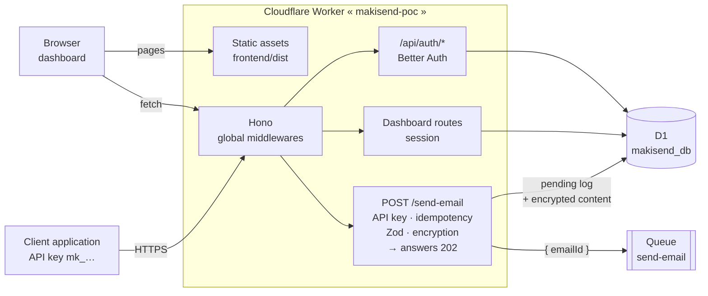
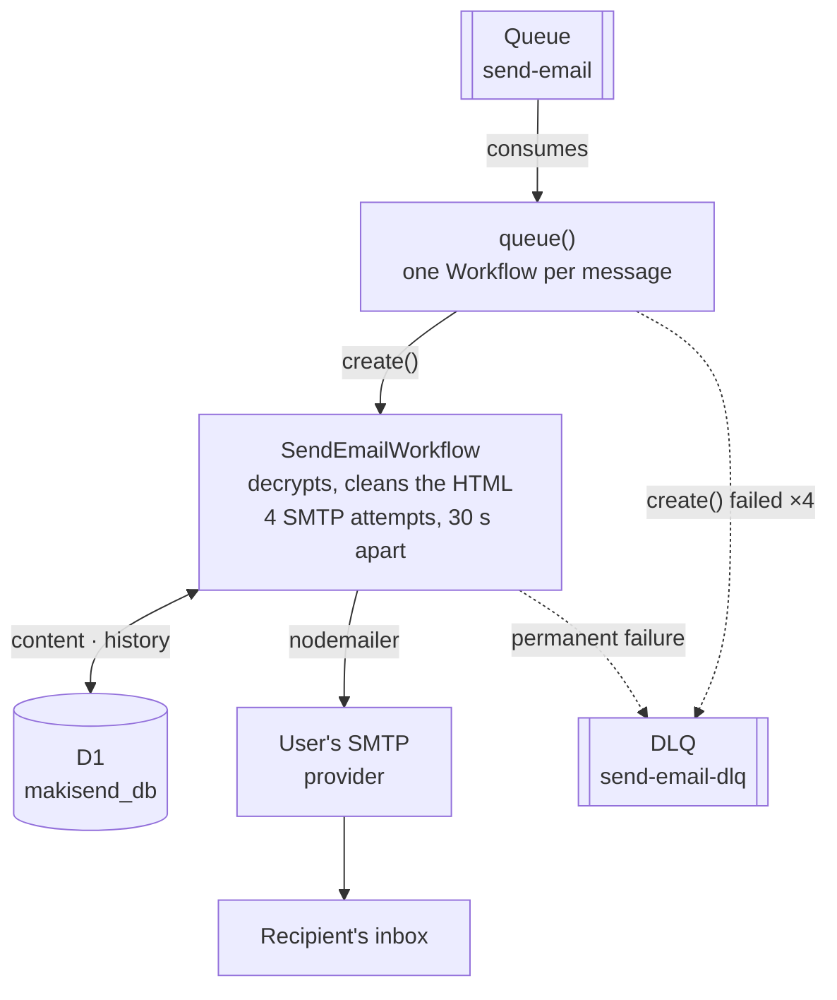

# MakiSend

**Transactional email, one API call away. No mail server to run.**

[](https://deploy.workers.cloudflare.com/?url=https://github.com/lixalistudio-oss/makisend)

MakiSend is a self-hosted, serverless email API on **Cloudflare Workers**. Your app sends one authenticated `POST /send-email`; MakiSend encrypts and queues the message, then delivers it through **your own SMTP provider** with automatic retries, and shows every delivery in a dashboard.

## Why MakiSend

- **No server to run.** One Worker serves the API and the dashboard; Queues and Workflows handle delivery.
- **Bring your own SMTP.** Zoho, Gmail, Microsoft 365, Resend, SendGrid, Mailgun or Cloudflare Email Service. You keep your sender domain and reputation.
- **Reliable delivery.** `202` right away, then a durable Workflow with bounded retries and a dead-letter queue.
- **Inbox, not spam.** In our tests, MakiSend emails land in the inbox once SPF, DKIM and DMARC are set on the sender domain.
- **Fast enough to feel instant.** 300–400 ms from queue to SMTP provider in the best cases, about 2 s in the worst (see [Delivery speed](#delivery-speed)).
- **Private by default.** Recipients, bodies, attachments and SMTP credentials are encrypted with AES-256-GCM before they reach D1.
- **Built for teams of one.** Per-user API keys, optional send quota, idempotency keys, 2FA, and a dashboard with logs, metrics and templates.
- **Resend-shaped API.** Same `attachments` format, so a client written for Resend sends the same JSON.

> **Status: early.** The sending pipeline, dashboard and security basics work end to end. Webhooks, bounce tracking and multi-provider failover are not built yet (see [Known limitations](#known-limitations-and-constraints) and [Roadmap](#roadmap)).

**Further reading:** [`docs/ARCHITECTURE.md`](./docs/ARCHITECTURE.md) (the full system), [`docs/DEVELOPER_GUIDE.md`](./docs/DEVELOPER_GUIDE.md) (run, change, test, debug), [`AGENTS.md`](./AGENTS.md) (conventions), [`DESIGN.md`](./DESIGN.md) (visual system of the dashboard and the website), [`CONTRIBUTING.md`](./CONTRIBUTING.md).

---

## Architecture

A single **Cloudflare Worker** serves both the dashboard (static Astro build) and the Hono API. Sending is **asynchronous**.

**1. HTTP request**: what happens during the call.



**2. Asynchronous delivery**: what happens after the `202`.



The journey of an email:

1. The client calls `POST /send-email` with its API key. The key determines the user **and** the SMTP configuration; the request body cannot choose them.
2. The Worker encrypts the recipient and the content, writes a `pending` log to D1, queues `{ emailId }` (no personal data goes through the Queue) and answers `202`.
3. The consumer starts one Workflow per email (instance id = `emailId`, so a duplicate is rejected).
4. The Workflow sends over SMTP and appends every step to `email_histories`, visible in the dashboard.
5. Transient error: 3 more attempts, 30 s apart. Permanent error (auth, TLS, DNS, config, 5xx) or exhausted budget: status `failed` and DLQ. The consumer itself only retries starting the Workflow (exponential backoff, then DLQ).

Two crons complete the picture: a daily SMTP health check of every configuration and an hourly [key rotation](#security) job. The full architecture board is [`makisend-design.excalidraw`](./makisend-design.excalidraw) (open it on [excalidraw.com](https://excalidraw.com) or with the Excalidraw plugin for Obsidian / VS Code).

**Stack:** [Hono](https://hono.dev/), [Zod](https://zod.dev/), [Drizzle ORM](https://orm.drizzle.team/) on [D1](https://developers.cloudflare.com/d1/), [Queues](https://developers.cloudflare.com/queues/) + [Workflows](https://developers.cloudflare.com/workflows/), [nodemailer](https://nodemailer.com/), [Better Auth](https://www.better-auth.com/), [Pino](https://getpino.io/), Web Crypto (AES-256-GCM), `sanitize-html`, [Vitest](https://vitest.dev/); dashboard in Astro + React (shadcn/ui).

```
makisend/
├── backend/     # Cloudflare Worker: one folder per module (controller → service → repository + dto),
│                # drizzle/ migrations, test/ (Vitest unit + Miniflare integration)
├── frontend/    # Astro + React dashboard, built into frontend/dist
├── docs/        # Architecture, developer guide, updating
└── .github/     # CI and deployment (GitHub Actions)
```

---

## Getting started

Prerequisites: Node.js 22+, pnpm, and SMTP credentials from a provider. A Cloudflare account is only needed to deploy: local development is simulated by Miniflare.

```bash
pnpm install
cp backend/.env.example backend/.env   # then fill it in (see Configuration)
pnpm --filter ./backend dev            # API on http://localhost:8787
pnpm --filter ./frontend dev           # dashboard on http://localhost:4321
```

The first connection to the dashboard creates the administrator account. Then create an SMTP configuration and an API key linked to it.

Backend commands, run from `backend/`: `pnpm test` (watch), `pnpm test:run`, `pnpm test:ui`, `pnpm test:coverage`, `pnpm lint`, `pnpm lint:fix`, `pnpm cf-typegen`. Migrations, end-to-end tests and debugging are in [`docs/DEVELOPER_GUIDE.md`](./docs/DEVELOPER_GUIDE.md).

### Configuration

Set in `backend/.env` locally, as Worker secrets once deployed:

| Variable | Description |
|----------|-------------|
| `ENCRYPTION_KEY` | AES-256 key, 64 hex characters (`openssl rand -hex 32`). **Keep a copy**: without it, stored data is unreadable. The legacy name `AES_256_KEY` is still read |
| `ENCRYPTION_KEY_PREVIOUS` | Optional, during a [key rotation](#security): previous keys, comma-separated (decrypt only) |
| `BETTER_AUTH_SECRET` | Signs sessions and encrypts the TOTP secrets (changing it breaks existing 2FA set-ups) |
| `BETTER_AUTH_URL`, `FRONTEND_URL` | Worker URL and allowed frontend origin. Optional once deployed: the dashboard and the API share one origin, so the request's origin is used |
| `SEND_RATE_LIMIT` | Optional per-API-key send quota, e.g. `100/min` or `5000/day` (`s`, `min`, `hour`, `day`). Over it: `429` with `Retry-After`. Unset: no quota |
| `UPDATE_CHECK` | Optional. `off` stops the daily new-release check (see [Updates](#updates)) |
| `MAKISEND_REPOSITORY` | Optional. Your copy of the repository (`owner/name`): the dashboard's **Update** button opens its sync workflow |
| `UPDATE_SOURCE_REPOSITORY` | Optional. Read releases from another repository. Default `lixalistudio-oss/makisend` |

SMTP credentials and API keys are not environment variables: they are managed in the dashboard and stored encrypted in D1.

### Development with Docker

```bash
pnpm docker:build
pnpm docker:up        # API :8787 (wrangler dev --local), dashboard :4321
pnpm docker:test      # also: docker:lint, docker:migrate, docker:down
```

Hot reload works on both services, local D1/Queues/Workflows state persists in `backend/.wrangler`, and no secret is copied into the image. Do not run `pnpm dev` on the host at the same time (port 8787). A devcontainer (`.devcontainer/`) reuses the same compose file.

---

## SMTP providers

The SMTP form offers presets (Zoho Mail, Gmail / Google Workspace, Microsoft 365, Resend, SendGrid, Mailgun, Cloudflare Email Service) that fill the hostname, port and security, and say what the form cannot guess (app password, `apikey` user name...). A pasted URL (`https://smtp.zoho.com:587/`) is cleaned into a hostname and a port. Port and TLS mode (`tls` or `starttls`) belong to each configuration; port 25 is rejected. Credentials can be checked before saving, and a saved configuration can send a test email, attachments included, from the dashboard.

**Cloudflare Email Service** (`smtp.mx.cloudflare.net`): a Worker cannot open an SMTP socket to it, so such a configuration is sent through the Worker's `send_email` binding (`EMAIL`), and its user name and password are not used. The sender address must use a domain onboarded to Cloudflare Email Sending.

---

## API

The Worker serves its own reference: a guide in the dashboard (`/dashboard/api-docs`), Scalar at `/docs` and OpenAPI 3.1 at `/openapi.json`. Request schemas are generated from the Zod DTOs, so they match the actual validation.

| Method | Route | Auth | Description |
|--------|-------|------|-------------|
| `POST` | `/send-email` | API key | Queues an email: inline content or `templateId`; supports `Idempotency-Key` |
| `GET/POST` | `/smtp-config` | Session | Lists / creates an SMTP configuration |
| `GET/PUT/DELETE` | `/smtp-config/{id}` | Session | Reads / updates / deletes a configuration |
| `POST` | `/smtp-config/check`, `/smtp-config/{id}/check` | Session | Tests unsaved / saved credentials |
| `POST` | `/smtp-config/{id}/test-send` | Session | Sends a test email (logged as `test`, never counted in the dashboard totals) |
| `GET/POST` | `/api-keys` | Session | Lists / creates an API key linked to a configuration (several keys can share one) |
| `DELETE` | `/api-keys/{id}` | Session | Revokes an API key |
| `GET` | `/email-logs`, `/email-logs/{id}` | Session | Paginated logs (filters `status`, `smtpConfigId`, `apiKeyId`, `to`) / one log and its history |
| `GET` | `/dashboard/stats`, `/by-config`, `/by-api-key`, `/recent`, `/errors` | Session | Delivery metrics (API sends only) |
| `GET/POST` | `/templates` | Session | Lists / creates a template |
| `GET/PUT/DELETE` | `/templates/{id}` | Session | Reads / updates / deletes a template |
| `POST` | `/templates/{id}/preview` | Session | Renders the template with sample variables |
| `GET` | `/updates/status` | Session | Installed and latest versions (`?refresh=true` checks now) |

`/api/auth/*` is served by Better Auth (sign-in, session, sign-out, 2FA).

### `POST /send-email`

Send the API key as `x-api-key: <KEY>` or `Authorization: Bearer <KEY>`.

```json
{
  "to": "recipient@example.com",
  "subject": "Email subject",
  "text": "Plain-text version of the message.",
  "html": "<p>HTML version of the message.</p>",
  "attachments": [
    { "filename": "receipt-REC-1.pdf", "content": "JVBERi0xLjQK…", "content_type": "application/pdf" }
  ]
}
```

| Field | Constraints |
|-------|-------------|
| `to` | Valid email |
| `subject` | At least 3 characters |
| `text` | At least 10 characters |
| `html` | Not empty; sanitized before sending |
| `attachments` | Optional. At most 5 files of 512 KB each (decoded). `content` is standard base64 without line breaks; `content_type` defaults to `application/octet-stream`; `filename` is at most 200 characters, without `/`, `\` or control characters. Resend's `path` (a URL to fetch) is refused |

Instead of `subject`/`text`/`html`, send `templateId` and `variables`: the template is rendered before queueing, and a missing variable answers `400` with the missing names. Mixing both shapes, or sending an unknown field, is rejected. Attachments work with both shapes: they are stored encrypted in D1, one row per file, never go through the queue, and are sent by SMTP and by the Cloudflare `send_email` binding alike.

---

## Deployment

Our deployments go **only through GitHub Actions** (`.github/workflows/deploy.yml`); nothing is deployed from a local machine.

| Trigger | Effect |
|---------|--------|
| Pull request to `main` or `dev` | Preview Worker `makisend-poc-preview`, with a D1 database recreated on every deploy and its own `-preview` queues |
| Push | Remote D1 migrations, queue creation if needed, then deploy of the `makisend-poc` Worker |

Both jobs run after lint, tests and the frontend build. The Cloudflare configuration is `backend/wrangler.jsonc`. GitHub secrets: `CLOUDFLARE_API_TOKEN`, `CLOUDFLARE_ACCOUNT_ID`, `AES_256_KEY` (preview), `BETTER_AUTH_SECRET`. The production Worker reads its own Cloudflare secrets (see [Configuration](#configuration)); the job checks that they exist.

### Deploy to Cloudflare (one click)

The button at the top of this page copies the repository into your GitHub (or GitLab) account, lets you name the Worker, the D1 database and the queues, asks for `ENCRYPTION_KEY` (`openssl rand -hex 32`, **keep a copy**) and `BETTER_AUTH_SECRET` (`openssl rand -base64 32`), then creates the resources and deploys with Workers Builds. Open the Worker's URL to create the administrator account, turn on 2FA and, if the API is reachable from the internet, set `SEND_RATE_LIMIT`.

The button uses the **root** `wrangler.jsonc` and `package.json`; a test keeps them in sync with `backend/wrangler.jsonc` (details in [`AGENTS.md`](./AGENTS.md)).

### Updates

The dashboard shows a banner when a newer release is published, and **Settings → MakiSend version** shows the installed and latest versions. The Worker reads the latest GitHub release once a day (unauthenticated, nothing about the instance is sent). Installing an update means merging the release into your copy, which redeploys it: run the **Sync with upstream** workflow shipped in every copy, or merge by hand. Guide, rollback and how releases are cut: [`docs/UPDATING.md`](docs/UPDATING.md).

### Self-hosting with an agent

[`docs/AGENT_SELF_HOST.md`](docs/AGENT_SELF_HOST.md) is a prompt for a coding agent: it creates the resources on your Cloudflare account with the `cf` CLI, sets the secrets, deploys and applies the security practices below.

---

## Security

- **API keys** per user (Better Auth): `401` without a key, `403` for an invalid one. Dashboard routes use the Better Auth session.
- **Encryption at rest**: SMTP credentials, recipients, bodies and attachments (AES-256-GCM). SMTP passwords are never returned by the API.
- **Key rotation**: copy the current key into `ENCRYPTION_KEY_PREVIOUS` and set a new `ENCRYPTION_KEY`; the hourly cron re-encrypts everything and logs `remaining`. Once it logs `remaining: 0` and `failed: 0`, delete `ENCRYPTION_KEY_PREVIOUS`. Never replace the key outright while the database holds data.
- **One account**: the first connection (`/setup`) creates the only account; every later creation is refused (403), atomically, on every creation path. Deleting the account makes the instance configurable again.
- **Two-factor authentication**: TOTP from Settings, with backup codes and an optional 30-day trusted device. Once it is on, the account can opt in to sign in with email + code only (off by default, one use per code, 10 wrong codes lock the account for 15 minutes).
- **Inputs and transport**: Zod `.strict()` validation, HTML cleaned with `sanitize-html`, verified TLS (`rejectUnauthorized: true`).

**Limitations:**

- **Send quota is opt-in.** Sign-in attempts are always rate limited per IP, but without `SEND_RATE_LIMIT` a leaked key can send until it is revoked. Set it on any instance whose API is reachable from the internet: `cf workers secrets update SEND_RATE_LIMIT --worker <worker> --type secret_text --text "100/min"`.
- No API key scopes or automatic rotation, no password reset by email, no webhook signatures, no audit log beyond the application logs.

---

## Delivery speed

`POST /send-email` answers `202` in milliseconds; the send happens right after, in the Workflow. From there to the provider accepting the message:

| Case | Time to the SMTP provider |
|------|---------------------------|
| Best case | 300–400 ms |
| Worst case | about 2 s |

Most of that time is the SMTP protocol, not MakiSend. SMTP waits for a reply to each command before sending the next ([RFC 5321](https://www.rfc-editor.org/rfc/rfc5321)), and on high-latency links this turnaround time dominates ([RFC 2920](https://www.rfc-editor.org/rfc/rfc2920)). One send is a chain of round trips (TCP connect, TLS handshake, `EHLO`, `AUTH`, `MAIL FROM`, `RCPT TO`, `DATA`, the message, `QUIT`), and a Worker opens a fresh connection for every email. Commonly cited figures put an SMTP send at 200 ms to 1 s, against roughly 100–500 ms for an HTTP email API ([comparison](https://resources.mailertogo.com/comparisons/smtp-relay-vs-email-api-developers-complete-comparison)). Delivery to the inbox then depends on the receiving server.

## Known limitations and constraints

- **No fixed outbound IP**: Workers connect from shared, changing Cloudflare IPs, so a provider that requires IP allow-listing will refuse sends. Disable allow-listing and rely on the SMTP credentials, or run the service on a server with a fixed IP.
- **Asynchronous only**: the outcome of a send is visible in the dashboard logs, not in the `202` response.
- **One SMTP provider per configuration**: no multi-provider routing or failover.
- **No tracking**: no bounce, open or click tracking; only send logs.
- **D1** is serverless SQLite: possible latency, not suited to very high volumes without caching.
- **Deliverability**: SPF, DKIM, DMARC and IP reputation depend on the SMTP provider and the sender domain.

## Roadmap

Available today: everything above (API-key sending, async pipeline with retries and DLQ, per-configuration SMTP, templates with the React Email builder or pasted TSX, encrypted logs, idempotency, health checks, dashboard metrics, OpenAPI docs, CI and deployment).

Next:

- Scale and throughput tuning of the queue and workflow pipeline
- Deliverability improvements (anti-spam, SPF/DKIM/DMARC)
